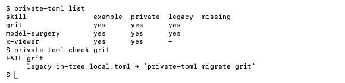

# private-toml

**Keep a published tool's private settings out of its repository — by location, not by exclude list.**



A tool that ships to GitHub still needs machine-only values: drive paths, account handles,
password hashes, binary locations. Keeping them in an in-repo `local.toml` and *excluding* it works
until one manifest forgets the exclude. `private-toml` moves the real file outside the tree entirely.

| File | Location | Published |
|---|---|---|
| `local.example.toml` | in the tool's folder | yes — same keys, `<placeholder>` values |
| `<tool>.toml` | `$CLAUDE_DIR/private/` (default `~/.claude/private/`) | never — not in the tree |

## Install

```sh
ln -s "$PWD/private-toml.py" ~/.local/bin/private-toml   # Python 3.11+, no dependencies
```

## Use

```sh
private-toml list                 # who is on the system, who still has a legacy local.toml
private-toml check all            # exit 1 if any tool is missing keys or still leaks
private-toml migrate my-tool      # legacy local.toml → private file + generated example
private-toml init my-tool         # new machine: private file from the example, then fill it
private-toml path my-tool         # path for scripts
```

`check` fails when a tool has no example, no private file, a key the example promises but the
private file lacks, a legacy in-tree `local.toml`, or a private literal in files that would ship.
Leak patterns come from an optional `$CLAUDE_DIR/github-publish-guard/patterns.toml`
(`[paths]` / `[identity]` regex lists); `.github-publish.toml` `excludes` and `allow` are honoured.

Tools are discovered under `$CLAUDE_DIR/skills/`. Symlinked aliases count once.

## Layout

`private-toml.py` dispatches to `commands/*.py` (drop a file = new command). `lib/` holds one
function per file.

## License

MIT
